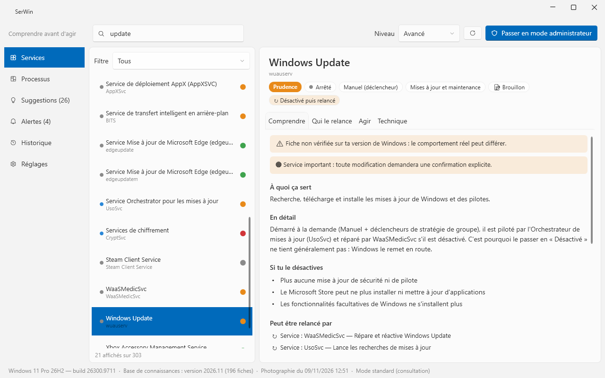
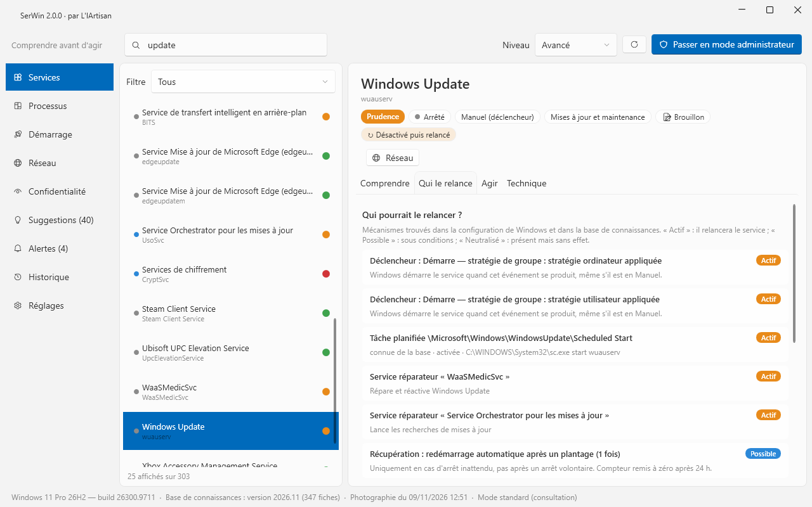
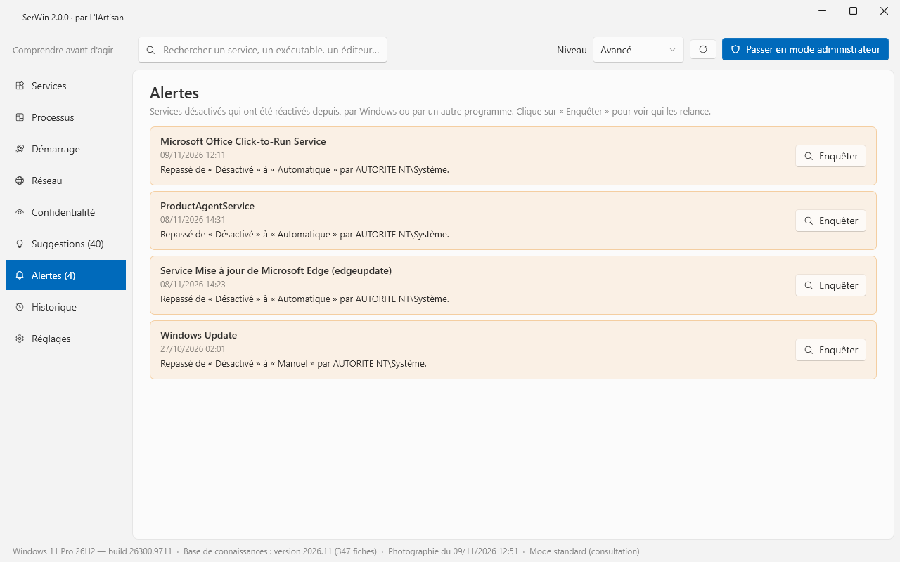
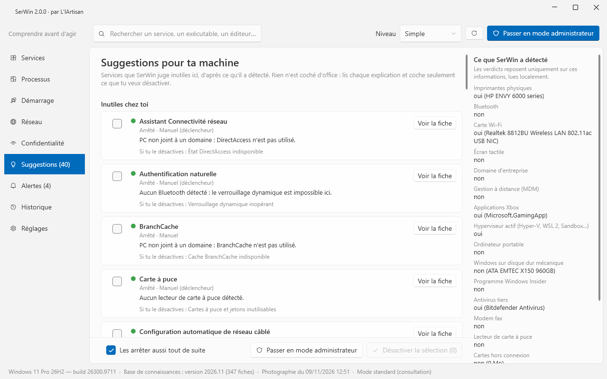

# SerWin

**Comprendre avant d'agir.** SerWin explique chaque service Windows avec des mots simples, montre ce qui casse si on le coupe, et révèle **pourquoi un service désactivé finit toujours par revenir**. Chaque modification est sauvegardée et s'annule d'un clic.

🇬🇧 [Read in English](README.md)

## Pourquoi SerWin ?

La plupart des « optimiseurs » Windows proposent un gros bouton qui désactive des dizaines de services d'un coup, sans dire ce qu'on perd — et la moitié revient discrètement à la mise à jour suivante. SerWin fait l'inverse :

- **Il explique.** 196 services décrits à trois niveaux — *Simple*, *Avancé*, *Expert* — en français et en anglais : à quoi il sert, ce qui ne marche plus sans lui, s'il touche à ta vie privée.
- **Il s'adapte à *ton* PC.** SerWin détecte ton matériel localement (imprimante, Bluetooth, Wi-Fi, portable ou fixe, applis Xbox, antivirus tiers…) et te dit quels services sont inutiles *sur cette machine*.
- **Il montre qui relance un service.** Déclencheurs, tâches planifiées, services réparateurs (WaaSMedic…), actions de récupération, mises à jour : SerWin liste tout ce qui peut faire revenir un service, et t'alerte quand c'est arrivé.
- **Il montre qui parle à Internet.** La page Réseau liste quel programme ou service contacte quel serveur, et explique à quoi sert chaque destination — sans que SerWin ne se connecte jamais lui-même.
- **Il ne coupe jamais les ponts.** Sauvegarde complète avant chaque modification, historique, annulation en un clic, *Tout restaurer*, point de restauration. Les services vitaux sont bloqués ; les services importants demandent une confirmation explicite.

### Qui le relance ?

### Alertes « désactivé puis relancé »

### Suggestions pour ta machine

Rien n'est coché d'office : lis chaque explication et choisis seulement ce que tu veux.

## Fonctionnalités

| | |
|---|---|
| **Services** | Recherche et filtres, explications claires, niveau de risque, type de démarrage, dépendances, déclencheurs, détails techniques, commandes `sc.exe` / PowerShell équivalentes |
| **Actions sûres** | Démarrer, arrêter, changer le type de démarrage, sauvegarde + historique + annulation, *Tout restaurer*, point de restauration, liste rouge (bloqué) et orange (confirmation) |
| **Qui le relance** | Analyse de 7 familles de mécanismes de relance + chronologie des journaux d'événements, alertes « désactivé puis relancé » |
| **Processus** | Arbre parent → enfant, svchost dépliés, CPU / RAM / disque par service, signatures Authenticode vérifiées hors ligne, emplacements suspects |
| **Réseau** *(v1.1)* | Qui contacte quoi : connexions TCP en direct avec le programme ou le service Windows exact, nom des serveurs grâce au journal DNS de Windows (facultatif, annulable), 61 fiches générales qui expliquent à quoi sert chaque destination (télémétrie, mises à jour, certificats, publicité…), ce qui casse si on la bloque et le réglage officiel qui la réduit. Observation seulement : rien n'est bloqué |
| **Chez toi** | 15 critères détectés localement, verdict « utile / inutile ici », suggestions vie privée, comparaison avec les réglages d'usine |
| **Mode Expert** | Neutralisation complète (service + tâches liées + déclencheurs + récupération, annulable à l'octet près), verrouillage ACL de la clé de registre |

## 🔒 Zéro réseau, zéro télémétrie

**SerWin ne se connecte jamais à Internet.** Aucune télémétrie, aucune statistique d'usage, aucune vérification de mise à jour, aucun service d'IA. La base de connaissances est intégrée à l'exécutable. La page Réseau ne fait que *lire* ce que Windows sait déjà (sa table des connexions et, si tu l'actives, son propre journal DNS).

Tout ce que SerWin écrit reste sur ta machine, en JSON lisible :

| Emplacement | Contenu |
|---|---|
| `%ProgramData%\SerWin\snapshot.json` | Photographie de tous les services prise au premier lancement |
| `%ProgramData%\SerWin\history.json` | Historique de toutes les modifications (chacune annulable) |
| `%ProgramData%\SerWin\backups\*.json` | Sauvegarde complète (config SCM, clé de registre, ACL) avant chaque modification |
| `%AppData%\SerWin\settings.json` | Tes préférences (langue, niveau) |

En mode administrateur, SerWin réserve l'écriture de `%ProgramData%\SerWin\` aux administrateurs, pour qu'un compte standard ne puisse pas falsifier une sauvegarde.

## Installer

- **Portable** : télécharger `SerWin-vX.Y.Z-win-x64.exe` depuis la [dernière version](https://github.com/L-IArtisan/SerWin/releases/latest) et le lancer. Rien à installer, .NET inclus. `SHA256SUMS.txt` permet de vérifier le fichier (`Get-FileHash`).
- **winget** *(bientôt)* : `winget install LIArtisan.SerWin`

Consulter ne demande aucun droit administrateur. Pour modifier, le bouton 🛡️ relance SerWin en administrateur.

> L'exécutable n'est pas encore signé : au premier lancement, Windows SmartScreen peut afficher « Windows a protégé votre ordinateur » → *Informations complémentaires* → *Exécuter quand même*. La signature via SignPath Foundation est en cours.

## État

Version 1.1 — 196 fiches services, 38 fiches processus et 61 fiches destinations réseau, toutes au niveau 📝 **Brouillon** : rédigées à partir de la documentation publique et contrôlées sur une vraie configuration Windows 11, mais pas encore vérifiées sur une installation vierge de chaque édition. SerWin affiche toujours le niveau de vérification de chaque fiche.

Une explication fausse, un service sans fiche ? [Ouvre un ticket](https://github.com/L-IArtisan/SerWin/issues/new/choose) : c'est la contribution la plus utile.

## Contribuer

Voir [CONTRIBUTING.fr.md](CONTRIBUTING.fr.md) : compilation, rédaction et vérification des fiches, traductions, publication.

## Licences

- Code : [GPL-3.0-or-later](LICENSE)
- Base de connaissances (`knowledge/`) : [CC BY-SA 4.0](knowledge/LICENSE)

Réalisé par [L'IArtisan](https://github.com/L-IArtisan).
