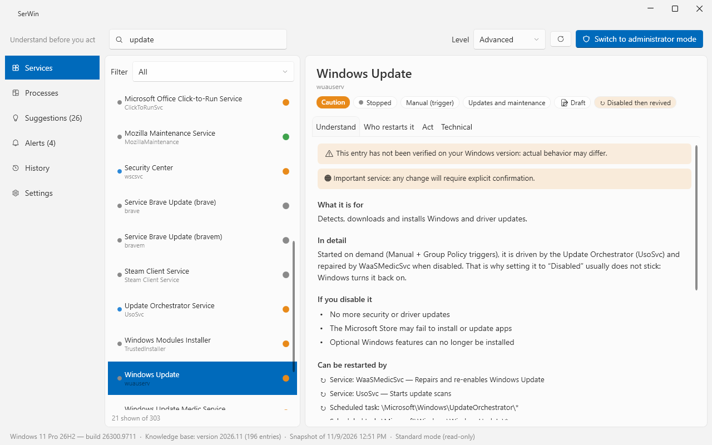
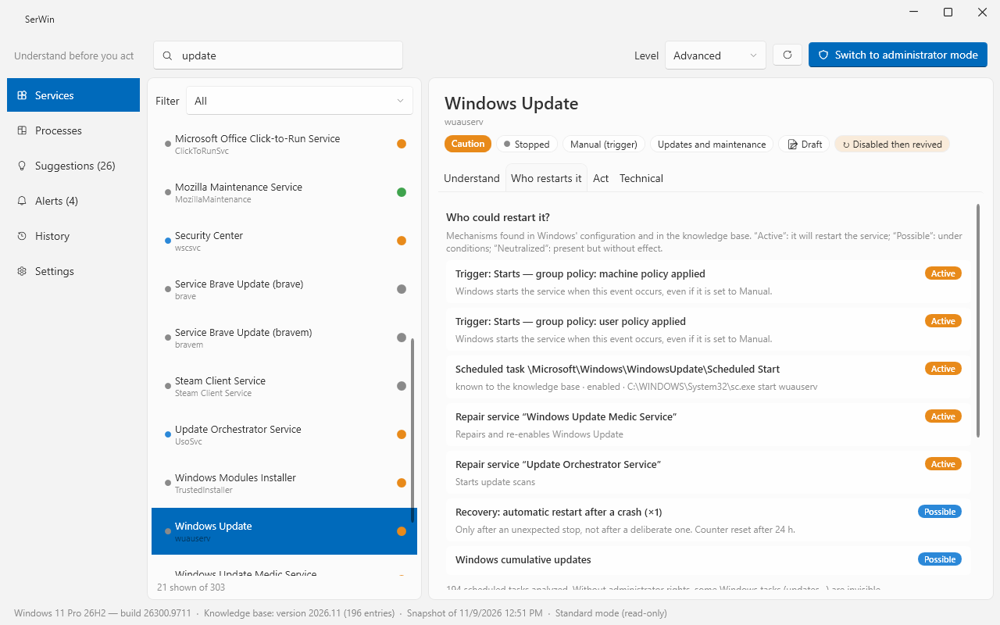
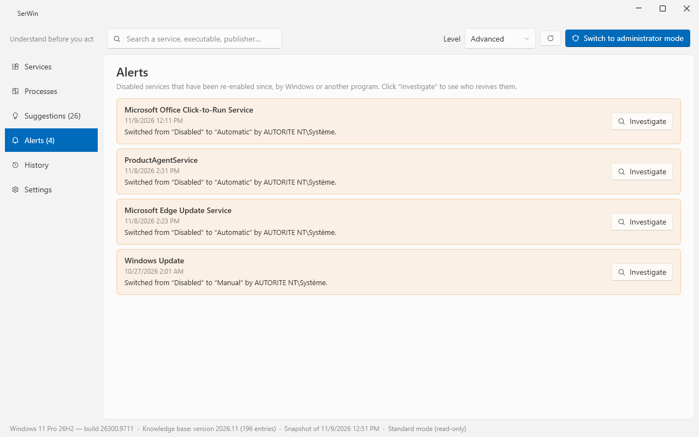
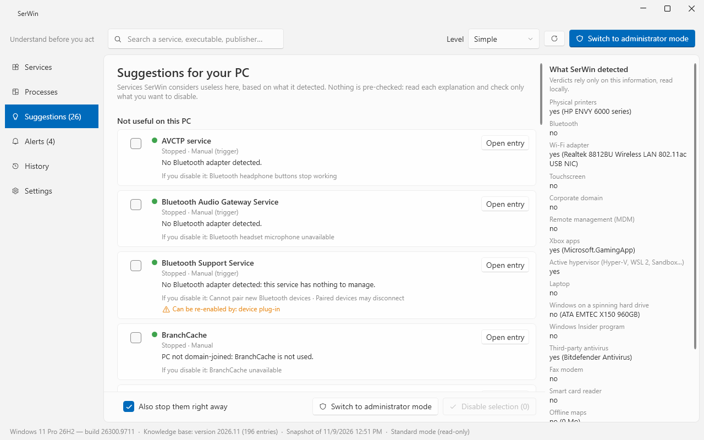

# SerWin

**Understand before you act.** SerWin explains every Windows service in plain words, shows what breaks if you turn it off, and reveals **why a disabled service keeps coming back**. Every change is backed up and can be undone in one click.

🇫🇷 [Lire en français](README.fr.md)

## Why SerWin?

Most "Windows optimizers" offer a big button that disables dozens of services at once, without telling you what you lose — and half of those services quietly come back after the next update. SerWin takes the opposite approach:

- **It explains.** 347 services described at three levels — *Simple*, *Advanced*, *Expert* — in English and French: what it does, what stops working without it, whether it touches your privacy. Services without a written entry get an automatic one, deduced from what is installed on your PC.
- **It adapts to *your* PC.** SerWin detects your hardware locally (printer, Bluetooth, Wi-Fi, laptop or desktop, Xbox apps, third-party antivirus…) and tells you which services are useless *on this machine*.
- **It shows who restarts a service.** Triggers, scheduled tasks, repair services (WaaSMedic…), recovery actions, updates: SerWin lists every mechanism that can bring a service back, and alerts you when one actually did.
- **It shows who talks to the Internet.** The Network page lists which program or service contacts which server, and explains what each destination is for — without SerWin itself ever connecting to anything.
- **It never burns bridges.** Full backup before every change, history, one-click undo, *Restore everything*, optional restore point. Critical services are hard-blocked; important ones need explicit confirmation.

### Who restarts it?

### Alerts: "disabled, then revived"

### Suggestions for your PC

Nothing is pre-checked: read each explanation and pick only what you want.

## Features

| | |
|---|---|
| **Services** | Search and filters, plain-language explanations, risk level, startup type, dependencies, triggers, technical details, equivalent `sc.exe` / PowerShell commands |
| **Safe actions** | Start, stop, change startup type, backup + history + undo, *Restore everything*, restore point, red list (blocked) and orange list (confirmation) |
| **Who restarts it** | Static analysis of 7 families of revival mechanisms + event-log timeline, "disabled then revived" alerts |
| **Processes** | Parent → child tree, svchost groups expanded, CPU / RAM / disk per service, offline Authenticode signature check, suspicious locations |
| **Network** *(v1.1)* | Who contacts what: live TCP connections with the exact program or Windows service, server names from the Windows DNS log (optional, undoable), 61 general entries describing what each destination is for (telemetry, updates, certificates, ads…), what breaks if blocked, and the official setting that reduces it. Observation only: nothing is blocked |
| **Your PC** | 15 local detection criteria, "useful / useless here" verdict, privacy suggestions, comparison with factory settings |
| **Expert mode** | Full neutralization (service + linked tasks + triggers + recovery, byte-exact undo), registry key ACL lock |

## 🔒 Zero network, zero telemetry

**SerWin never connects to the Internet.** No telemetry, no usage statistics, no update check, no AI service. The knowledge base is built into the executable. The Network page only *reads* what Windows already knows (its connection table and, if you turn it on, its own DNS log).

Everything SerWin writes stays on your machine, as readable JSON:

| Location | Content |
|---|---|
| `%ProgramData%\SerWin\snapshot.json` | Snapshot of all services taken at first launch |
| `%ProgramData%\SerWin\history.json` | History of every change (each one can be undone) |
| `%ProgramData%\SerWin\backups\*.json` | Full backup (SCM config, registry key, ACL) before each change |
| `%AppData%\SerWin\settings.json` | Your preferences (language, level) |

## Install

- **Portable:** download `SerWin-vX.Y.Z-win-x64.exe` from the [latest release](https://github.com/L-IArtisan/SerWin/releases/latest) and run it. Nothing to install, .NET included. Check the file against `SHA256SUMS.txt` with `Get-FileHash`.
- **winget** *(coming soon)*: `winget install LIArtisan.SerWin`

Browsing needs no admin rights. To make changes, the 🛡️ button restarts SerWin as administrator.

> The executable is not code-signed yet: on first launch, Windows SmartScreen may show "Windows protected your PC" → *More info* → *Run anyway*. Signing through SignPath Foundation is in progress.

## Status

Version 1.1 — 347 service entries, 38 process entries and 61 network destinations, all marked 📝 **Draft**: written from public documentation and checked against a real Windows 11 configuration, but not yet verified on a clean install of every edition. SerWin always shows the verification level of each entry.

Found a wrong explanation, or a service without an entry? [Open an issue](https://github.com/L-IArtisan/SerWin/issues/new/choose) — it is the most useful contribution.

## Contributing

See [CONTRIBUTING.md](CONTRIBUTING.md): build instructions, how knowledge-base entries are written and verified, translations, releases.

## License

- Code: [GPL-3.0-or-later](LICENSE)
- Knowledge base (`knowledge/`): [CC BY-SA 4.0](knowledge/LICENSE)

Made by [L'IArtisan](https://github.com/L-IArtisan).
